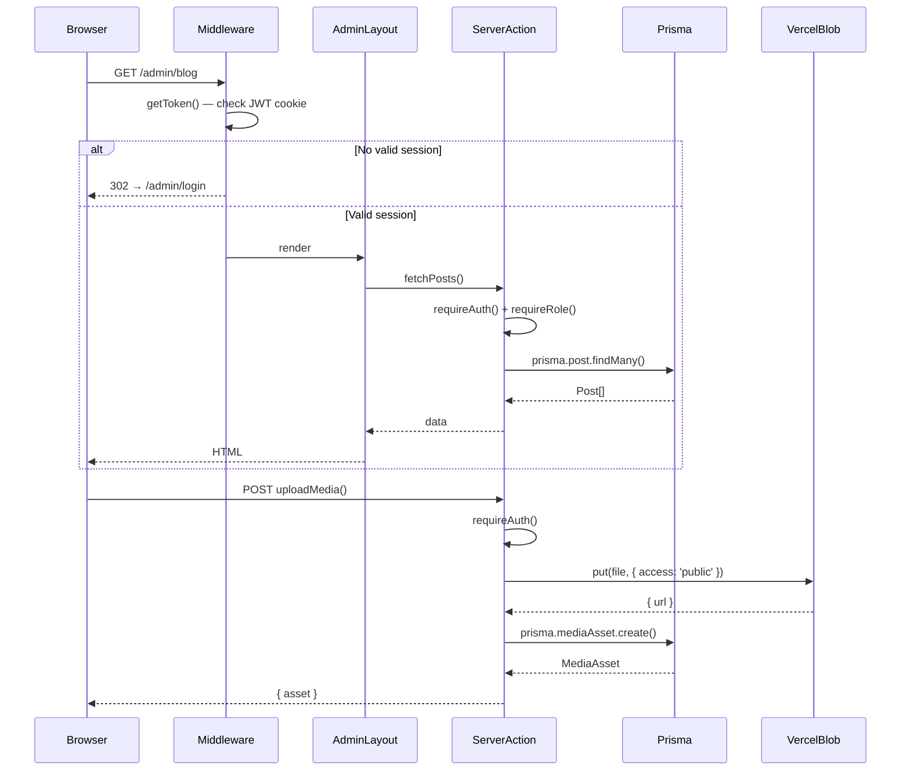
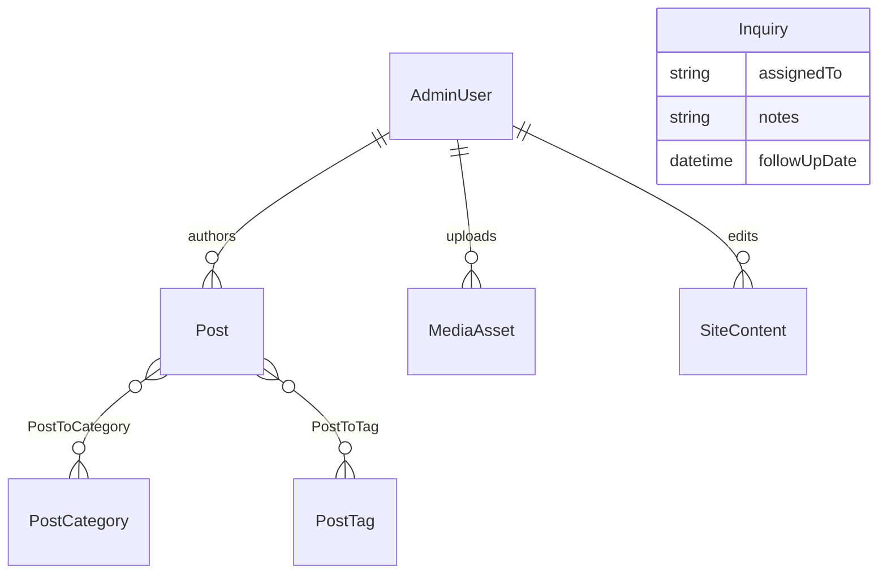

# Design Document

## Overview

The ONEFOCUS AFRICA Admin Dashboard and Blog CMS is a secure, private back-office layered on top of the existing public Next.js 15 website. It is entirely additive — every existing public page, API route, Prisma model, and integration is preserved without modification.

The system delivers:

- **Authenticated admin workspace** under the `/admin` route prefix, protected by NextAuth.js v5 with an HTTP-only JWT session cookie.
- **Blog authoring engine** — full lifecycle from DRAFT → REVIEW → SCHEDULED → PUBLISHED, powered by a Tiptap rich-text editor.
- **Public blog** at `/blog` and `/blog/[slug]` with static generation, ISR revalidation, Open Graph metadata, and JSON-LD structured data.
- **CMS controls** for editable website sections (hero, services, team, events, programs, contact info) without touching code.
- **Media library** backed by Vercel Blob for durable, CDN-served file storage.
- **Business inquiry management** — the existing contact form continues to write to the `Inquiry` model; admins manage leads via a new dashboard view that extends the model non-destructively.
- **Role-based access control** — two roles (`ADMIN`, `EDITOR`) enforced server-side on every action and route.

The UI follows a premium, minimalist enterprise aesthetic: dark navy (`#101D3A`) sidebar, white workspace, compact typography, and purposeful use of brand blue (`#1F99ED`) as the primary action colour. No gratuitous animations or decorative gradients.

---

## Architecture

### High-Level Structure

```
Next.js 15 App Router
├── app/
│   ├── (public)          ← existing routes, untouched
│   │   ├── page.tsx
│   │   ├── about/
│   │   ├── solutions/
│   │   ├── work/
│   │   ├── talent/
│   │   ├── contact/
│   │   ├── privacy/
│   │   └── terms/
│   ├── blog/             ← new public blog
│   │   ├── page.tsx
│   │   └── [slug]/
│   │       └── page.tsx
│   ├── sitemap.ts        ← extended to include published posts
│   └── admin/            ← protected workspace (new)
│       ├── layout.tsx    ← auth guard + sidebar/topbar shell
│       ├── login/
│       ├── page.tsx      ← /admin overview
│       ├── blog/
│       ├── media/
│       ├── content/
│       ├── portfolio/
│       ├── inquiries/
│       ├── programs/
│       ├── events/
│       ├── team/
│       └── settings/
├── components/
│   ├── admin/            ← admin-only UI components (new)
│   └── sections/         ← existing public components, untouched
├── lib/
│   ├── auth.ts           ← NextAuth config (new)
│   ├── auth-utils.ts     ← requireAuth(), requireRole() (new)
│   ├── slug.ts           ← slug generation helpers (new)
│   ├── upload.ts         ← Vercel Blob wrapper (new)
│   ├── sanitize.ts       ← DOMPurify server-side (new)
│   ├── prisma.ts         ← existing, untouched
│   ├── email.ts          ← existing, untouched
│   └── validations.ts    ← existing, untouched (admin schemas added separately)
├── middleware.ts          ← NextAuth session guard on /admin/* (new)
└── prisma/
    └── schema.prisma     ← extended with new models (new models only)
```

### Request Flow



### Authentication Architecture

NextAuth.js v5 (Auth.js) is configured with a **Credentials provider** only. No OAuth providers are included — admin accounts are staff-only, provisioned by existing admins or the seed command.

```
/admin/login form
    ↓ signIn('credentials', { email, password })
NextAuth CredentialsProvider
    ↓ prisma.adminUser.findUnique({ where: { email } })
    ↓ bcrypt.compare(password, hashedPassword)
    ↓ return { id, name, email, role }
JWT session (HTTP-only cookie, 8h maxAge, SameSite=Lax, Secure in prod)
    ↓
middleware.ts: getToken() on every /admin/* request
    ↓
Server Actions / Route Handlers: requireAuth() → requireRole()
```

Rate limiting for failed login attempts is enforced in the credentials `authorize` callback using an in-memory `Map<ip, { count, firstAttempt }>` (suitable for single-instance Vercel deployments; can be swapped for Vercel KV for multi-region).

### ISR and Cache Invalidation

| Trigger | `revalidatePath` calls |
|---|---|
| Post published / unpublished | `/blog`, `/blog/[slug]` |
| Post updated | `/blog/[slug]` |
| CaseStudy published / deleted | `/work` |
| SiteContent saved | affected public route |
| Program / Event status changed | `/talent` |

The `/sitemap.ts` is a dynamic route with `export const dynamic = 'force-dynamic'` so it always reflects the latest published posts without a separate revalidation step.

---

## Components and Interfaces

### Admin Shell Components

#### `app/admin/layout.tsx`
The root admin layout. Runs as a Server Component. Calls `auth()` from NextAuth — if no session, redirects to `/admin/login`. Renders the persistent sidebar and top bar around `{children}`.

```typescript
// Simplified interface
export default async function AdminLayout({
  children,
}: {
  children: React.ReactNode
})
```

#### `components/admin/Sidebar.tsx`
Client component. Renders the 240 px dark navy sidebar. Receives the current user's role as a prop and filters navigation items accordingly. Uses `usePathname()` to apply the active state (light blue `#EEF6FD` background, `#1F99ED` text).

```typescript
interface SidebarProps {
  role: 'ADMIN' | 'EDITOR'
  userName: string
}

const NAV_ITEMS: NavItem[] = [
  { label: 'Overview',            href: '/admin',            icon: GridIcon,    roles: ['ADMIN', 'EDITOR'] },
  { label: 'Blog & Articles',     href: '/admin/blog',       icon: FileTextIcon,roles: ['ADMIN', 'EDITOR'] },
  { label: 'Media Library',       href: '/admin/media',      icon: ImageIcon,   roles: ['ADMIN', 'EDITOR'] },
  { label: 'Website Content',     href: '/admin/content',    icon: LayoutIcon,  roles: ['ADMIN'] },
  { label: 'Portfolio',           href: '/admin/portfolio',  icon: BriefcaseIcon,roles: ['ADMIN'] },
  { label: 'Business Inquiries',  href: '/admin/inquiries',  icon: InboxIcon,   roles: ['ADMIN', 'EDITOR'] },
  { label: 'Programs & Events',   href: '/admin/programs',   icon: CalendarIcon,roles: ['ADMIN', 'EDITOR'] },
  { label: 'Team & Settings',     href: '/admin/team',       icon: UsersIcon,   roles: ['ADMIN'] },
]
```

#### `components/admin/TopBar.tsx`
Client component. 56 px compact bar showing breadcrumb on the left and user avatar / name / logout on the right. Hamburger button visible on mobile.

```typescript
interface TopBarProps {
  breadcrumbs: Array<{ label: string; href?: string }>
  userName: string
  userEmail: string
  onMobileMenuToggle: () => void
}
```

#### `components/admin/StatCard.tsx`
```typescript
interface StatCardProps {
  label: string
  value: number | string | null   // null renders '—'
  href?: string                    // optional link to detail view
}
```

#### `components/admin/DataTable.tsx`
Generic sortable, paginated table.

```typescript
interface DataTableProps<T> {
  columns: ColumnDef<T>[]
  data: T[]
  pagination?: PaginationState
  onPaginationChange?: (state: PaginationState) => void
  emptyMessage?: string
}
```

#### `components/admin/PageHeader.tsx`
```typescript
interface PageHeaderProps {
  title: string
  breadcrumbs: Array<{ label: string; href?: string }>
  action?: { label: string; href?: string; onClick?: () => void }
}
```

### Editor Components

#### `components/admin/editor/RichTextEditor.tsx`
Tiptap `useEditor` hook wrapped in a Client Component. Toolbar renders icon buttons for: H2, H3, Bold, Italic, BulletList, OrderedList, Blockquote, Link, Code, Undo, Redo.

```typescript
interface RichTextEditorProps {
  content: string            // JSON or HTML string
  onChange: (html: string) => void
  placeholder?: string
}
```

#### `components/admin/editor/SlugField.tsx`
```typescript
interface SlugFieldProps {
  value: string
  siteUrl: string            // e.g. https://onefocusafrica.com
  onChange: (slug: string) => void
  isUnique: boolean          // server-validated
}
```

#### `components/admin/editor/SeoFields.tsx`
```typescript
interface SeoFieldsProps {
  seoTitle: string
  seoDescription: string
  onTitleChange: (v: string) => void
  onDescriptionChange: (v: string) => void
  // char counter turns amber at 55/140, red at 60+/160+
}
```

#### `components/admin/editor/StatusSelector.tsx`
```typescript
type PostStatus = 'DRAFT' | 'REVIEW' | 'SCHEDULED' | 'PUBLISHED'

interface StatusSelectorProps {
  value: PostStatus
  onChange: (status: PostStatus) => void
  scheduledAt?: Date
  onScheduledAtChange?: (date: Date) => void
}
```

#### `components/admin/MediaGrid.tsx`
```typescript
interface MediaGridProps {
  assets: MediaAsset[]
  mode: 'library' | 'picker'    // 'picker' used inside modal from editor
  onSelect?: (asset: MediaAsset) => void
  onDelete?: (id: string) => void
}
```

### Server-side Utilities

#### `lib/auth.ts`
```typescript
import NextAuth from 'next-auth'
import Credentials from 'next-auth/providers/credentials'

export const { auth, handlers, signIn, signOut } = NextAuth({
  providers: [
    Credentials({
      authorize: async (credentials) => {
        // rate-limit check → findUnique → bcrypt.compare → return user
      },
    }),
  ],
  session: { strategy: 'jwt', maxAge: 8 * 60 * 60 },
  callbacks: {
    jwt: ({ token, user }) => { /* embed role */ },
    session: ({ session, token }) => { /* expose role */ },
  },
})
```

#### `lib/auth-utils.ts`
```typescript
// Throws redirect to /admin/login if no session
export async function requireAuth(): Promise<AdminSession>

// Throws 403 Response if role doesn't match
export async function requireRole(
  session: AdminSession,
  role: 'ADMIN'
): Promise<void>
```

#### `lib/slug.ts`
```typescript
export function generateSlug(title: string): string
  // lowercase → replace spaces with '-' → strip non-[a-z0-9-]

export async function ensureUniqueSlug(
  baseSlug: string,
  excludeId?: string
): Promise<string>
  // check DB, append -2, -3, ... until unique
```

#### `lib/upload.ts`
```typescript
const ALLOWED_MIME_TYPES = [
  'image/jpeg', 'image/png', 'image/webp',
  'image/gif', 'image/svg+xml', 'application/pdf',
]
const MAX_SIZE_BYTES = 10 * 1024 * 1024 // 10 MB

export async function uploadToBlob(
  file: File,
  uploadedById: string
): Promise<MediaAsset>
  // validate MIME → validate size → put() to Vercel Blob → prisma.mediaAsset.create()
```

#### `lib/sanitize.ts`
```typescript
// Server-side DOMPurify via jsdom — strips script tags, event handlers, etc.
export function sanitizeHtml(dirty: string): string
```

#### `middleware.ts`
```typescript
import { auth } from '@/lib/auth'

export default auth((req) => {
  const isAdminRoute = req.nextUrl.pathname.startsWith('/admin')
  const isLoginPage  = req.nextUrl.pathname === '/admin/login'
  if (isAdminRoute && !isLoginPage && !req.auth) {
    return Response.redirect(new URL('/admin/login', req.url))
  }
})

export const config = { matcher: ['/admin/:path*'] }
```

### Public Blog Components

#### `app/blog/page.tsx`
Server Component with `searchParams` for `page`, `category`, `q`. Fetches published posts server-side, renders `BlogCard` list with `<Pagination>` and `<CategoryFilter>` client islands.

#### `app/blog/[slug]/page.tsx`
Server Component. `generateStaticParams()` returns all published slugs. Calls `revalidatePath` on post publish. Renders full article with structured data JSON-LD.

```typescript
export async function generateStaticParams() {
  const posts = await prisma.post.findMany({
    where: { status: 'PUBLISHED' },
    select: { slug: true },
  })
  return posts.map((p) => ({ slug: p.slug }))
}

export async function generateMetadata({ params }: Props): Promise<Metadata> {
  // post.seoTitle, post.seoDescription, post.coverImage
}
```

---

## Data Models

The following models are **additions** to the existing Prisma schema. No existing model is altered or removed. The `Inquiry` model receives three new optional fields via a non-destructive migration.

### New Prisma Models

```prisma
enum AdminRole {
  ADMIN
  EDITOR
}

enum PostStatus {
  DRAFT
  REVIEW
  SCHEDULED
  PUBLISHED
}

enum ProgramStatus {
  active
  inactive
}

enum EventStatus {
  upcoming
  past
  cancelled
}

model AdminUser {
  id             String    @id @default(uuid())
  name           String
  email          String    @unique
  hashedPassword String
  role           AdminRole @default(EDITOR)
  isActive       Boolean   @default(true)
  lastLoginAt    DateTime?
  createdAt      DateTime  @default(now())
  updatedAt      DateTime  @updatedAt

  posts          Post[]
  mediaAssets    MediaAsset[]
  siteContents   SiteContent[]

  @@index([email])
  @@index([role])
}

model Post {
  id             String     @id @default(uuid())
  title          String
  slug           String     @unique
  content        String     @db.Text   // sanitized HTML
  excerpt        String?    @db.Text
  coverImage     String?                // CDN URL
  seoTitle       String?
  seoDescription String?
  status         PostStatus @default(DRAFT)
  scheduledAt    DateTime?
  publishedAt    DateTime?
  authorId       String
  author         AdminUser  @relation(fields: [authorId], references: [id])
  categories     PostCategory[] @relation("PostToCategory")
  tags           PostTag[]      @relation("PostToTag")
  createdAt      DateTime   @default(now())
  updatedAt      DateTime   @updatedAt

  @@index([slug])
  @@index([status])
  @@index([publishedAt])
  @@index([authorId])
}

model PostCategory {
  id    String @id @default(uuid())
  name  String @unique
  slug  String @unique
  posts Post[] @relation("PostToCategory")

  @@index([slug])
}

model PostTag {
  id    String @id @default(uuid())
  name  String @unique
  slug  String @unique
  posts Post[] @relation("PostToTag")
}

model MediaAsset {
  id            String    @id @default(uuid())
  filename      String                   // UUID-prefixed stored name
  originalName  String
  url           String                   // Vercel Blob CDN URL
  mimeType      String
  size          Int                      // bytes
  uploadedById  String
  uploadedBy    AdminUser @relation(fields: [uploadedById], references: [id])
  createdAt     DateTime  @default(now())

  @@index([uploadedById])
  @@index([mimeType])
}

model SiteContent {
  id          String    @id @default(uuid())
  section     String                   // e.g. "homepage_hero", "contact_info"
  key         String                   // e.g. "headline", "email"
  value       String    @db.Text
  updatedById String
  updatedBy   AdminUser @relation(fields: [updatedById], references: [id])
  updatedAt   DateTime  @updatedAt

  @@unique([section, key])
  @@index([section])
}

model Program {
  id          String        @id @default(uuid())
  title       String
  description String        @db.Text
  icon        String?
  status      ProgramStatus @default(active)
  urlAnchor   String?
  createdAt   DateTime      @default(now())
  updatedAt   DateTime      @updatedAt

  @@index([status])
}

model Event {
  id               String      @id @default(uuid())
  title            String
  description      String      @db.Text
  eventDate        DateTime
  location         String?
  status           EventStatus @default(upcoming)
  registrationLink String?
  createdAt        DateTime    @default(now())
  updatedAt        DateTime    @updatedAt

  @@index([status])
  @@index([eventDate])
}

model TeamMember {
  id        String   @id @default(uuid())
  name      String
  roleTitle String
  bio       String?  @db.Text
  photo     String?              // CDN URL
  sortOrder Int      @default(0)
  isActive  Boolean  @default(true)
  createdAt DateTime @default(now())
  updatedAt DateTime @updatedAt

  @@index([isActive])
  @@index([sortOrder])
}
```

### Non-Destructive Extension of `Inquiry`

Three new optional fields are appended to the existing `Inquiry` model. All existing fields remain unchanged:

```prisma
// Added to existing Inquiry model — no fields removed or renamed
model Inquiry {
  // ... all existing fields preserved ...

  // NEW optional fields (migration: ALTER TABLE ADD COLUMN ... NULL)
  assignedTo   String?       // admin display name
  notes        String?       @db.Text
  followUpDate DateTime?

  // existing indexes preserved
}
```

### Entity Relationship Overview



### Page-to-Data Mapping

| Admin Page | Primary Model(s) | Key Operations |
|---|---|---|
| `/admin` | `Post`, `Inquiry`, `CommunityMember` | COUNT aggregates, recent lists |
| `/admin/blog` | `Post` | filter, search, paginate, delete |
| `/admin/blog/new` | `Post`, `PostCategory`, `PostTag`, `MediaAsset` | create |
| `/admin/blog/[id]/edit` | `Post` | update, autosave |
| `/admin/media` | `MediaAsset` | upload, list, delete |
| `/admin/content` | `SiteContent` | upsert per section/key |
| `/admin/portfolio` | `CaseStudy` | CRUD |
| `/admin/inquiries` | `Inquiry` | filter, search, status update, notes |
| `/admin/programs` | `Program` | CRUD |
| `/admin/events` | `Event` | CRUD |
| `/admin/team` | `TeamMember`, `AdminUser` | CRUD |
| `/admin/settings` | `SiteContent` | upsert global config |

---

## Correctness Properties

*A property is a characteristic or behavior that should hold true across all valid executions of a system — essentially, a formal statement about what the system should do. Properties serve as the bridge between human-readable specifications and machine-verifiable correctness guarantees.*

### Property 1: Slug generation is URL-safe and deterministic

*For any* post title string, `generateSlug(title)` SHALL produce an output that contains only lowercase letters, digits, and hyphens, with no leading or trailing hyphens, and no consecutive hyphens.

**Validates: Requirements 5.5**

### Property 2: Slug uniqueness guarantee

*For any* base slug and any database state, `ensureUniqueSlug(baseSlug, excludeId)` SHALL return a slug that does not collide with any existing Post slug (excluding the post identified by `excludeId`), appending a numeric suffix as needed.

**Validates: Requirements 5.6, 13.4**

### Property 3: MIME type allowlist enforcement

*For any* uploaded file, `uploadToBlob()` SHALL reject files whose MIME type is not in the allowlist (`image/jpeg`, `image/png`, `image/webp`, `image/gif`, `image/svg+xml`, `application/pdf`) by throwing an error before any call to Vercel Blob is made.

**Validates: Requirements 8.3, 18.3**

### Property 4: File size limit enforcement

*For any* uploaded file exceeding 10 MB, `uploadToBlob()` SHALL reject the upload by throwing an error before any call to Vercel Blob is made.

**Validates: Requirements 8.4, 18.4**

### Property 5: Password hashing round-trip

*For any* plaintext password string, hashing with `bcrypt.hash(password, 12)` followed by `bcrypt.compare(password, hash)` SHALL return `true`; comparing any different plaintext string against that hash SHALL return `false`.

**Validates: Requirements 2.5, 16.3**

### Property 6: Role permission check — EDITOR restriction

*For any* server action or route handler that calls `requireRole(session, 'ADMIN')`, when the session holds the `EDITOR` role, the function SHALL throw a 403 Response and SHALL NOT proceed to execute the protected operation.

**Validates: Requirements 3.2, 3.4, 3.5**

### Property 7: HTML sanitization removes XSS vectors

*For any* HTML string passed to `sanitizeHtml()`, the returned string SHALL contain no `<script>` elements, no `javascript:` URI schemes, and no inline event handler attributes (e.g. `onerror`, `onload`).

**Validates: Requirements 20.3**

### Property 8: SEO character counter state

*For any* string of length `n`, the SEO title field counter SHALL render in the `neutral` state when `n ≤ 54`, in the `amber` state when `55 ≤ n ≤ 59`, and in the `red` state when `n ≥ 60`. The SEO description field counter SHALL render in the `neutral` state when `n ≤ 139`, in the `amber` state when `140 ≤ n ≤ 159`, and in the `red` state when `n ≥ 160`.

**Validates: Requirements 5.3, 5.4**

### Property 9: Published posts appear in sitemap; non-published posts do not

*For any* database state, the dynamic `/sitemap.ts` route SHALL include a `<url>` entry for every Post with `status = PUBLISHED` and SHALL NOT include entries for Posts with any other status.

**Validates: Requirements 11.1, 11.3**

### Property 10: Unauthenticated requests to admin routes are redirected

*For any* request to a path matching `/admin/*` (excluding `/admin/login`) that does not carry a valid NextAuth session token, the middleware SHALL return a redirect response to `/admin/login` and SHALL NOT render any admin content.

**Validates: Requirements 2.4, 20.7**

### Property 11: Last ADMIN account cannot be deactivated

*For any* `AdminUser` set where the count of active users with the `ADMIN` role equals exactly one, attempting to deactivate or delete that remaining ADMIN account SHALL be rejected with a descriptive error and the account SHALL remain active.

**Validates: Requirements 16.7**

---

## Error Handling

### Authentication Errors

| Scenario | Behaviour |
|---|---|
| Invalid credentials | Generic "Invalid email or password" — no field-level hint |
| Rate limit exceeded (5 attempts / 15 min) | "Too many attempts. Try again in 15 minutes." — 429 status |
| Expired session | Middleware redirects to `/admin/login` with `?expired=1` |
| Insufficient role | 403 page with "You don't have permission to view this page." |

### Form and Validation Errors

All Server Actions return a typed `ActionResult<T>` union:

```typescript
type ActionResult<T> =
  | { success: true; data: T }
  | { success: false; errors: Record<string, string[]>; message?: string }
```

Zod schemas validate input before any database call. Validation errors are mapped to field-level messages and returned to the client without re-fetching.

### Media Upload Errors

| Error | HTTP Status | User-facing message |
|---|---|---|
| Disallowed MIME type | 415 | "Only JPEG, PNG, WebP, GIF, SVG, and PDF files are accepted." |
| File too large (> 10 MB) | 413 | "File exceeds the 10 MB limit." |
| Blob storage failure | 500 | "Upload failed. Please try again." |

### Database Errors

Prisma unique constraint violations (e.g. duplicate slug, duplicate category name) are caught and surfaced as user-readable messages. Unhandled Prisma errors are logged server-side and return a generic 500 message to the client — no stack traces are exposed.

### Rich-Text Editor

Auto-save failures (network errors during the 30-second cycle) set the status indicator to "Unsaved changes — retrying…" and retry on the next cycle. A manual "Save Draft" button is always available. The user is warned with a `beforeunload` dialog if there are unsaved changes.

### Public Blog 404

Requests to `/blog/[slug]` where the slug does not match a PUBLISHED post call Next.js `notFound()`, which renders the existing `app/not-found.tsx` page.

---

## Testing Strategy

### Unit Tests

Vitest is the chosen test runner (fast, native ESM, works with Next.js without extra config). Test files live alongside source in `*.test.ts` files.

**Coverage targets:**

| Module | What is tested | Test type |
|---|---|---|
| `lib/slug.ts` — `generateSlug` | All Property 1 cases: lowercase, hyphenation, stripping of special chars, no leading/trailing/consecutive hyphens | Property-based (fast-check) |
| `lib/slug.ts` — `ensureUniqueSlug` | Uniqueness guarantee with mocked Prisma (Property 2) | Property-based (fast-check) |
| `lib/upload.ts` — MIME validation | All allowlisted and non-allowlisted MIME types (Property 3) | Property-based (fast-check) |
| `lib/upload.ts` — size validation | Files above and below 10 MB boundary (Property 4) | Property-based (fast-check) |
| `lib/auth-utils.ts` — `requireRole` | EDITOR blocked from ADMIN routes; ADMIN allowed (Property 6) | Property-based (fast-check) |
| `lib/sanitize.ts` — `sanitizeHtml` | Script tags, javascript URIs, event handlers stripped (Property 7) | Property-based (fast-check) |
| `components/admin/editor/SeoFields.tsx` | Character counter colour state at boundary values (Property 8) | Property-based (fast-check) |
| Password hashing | bcrypt round-trip correctness (Property 5) | Property-based (fast-check) |
| `app/sitemap.ts` | Only PUBLISHED posts included (Property 9) | Property-based (fast-check) |
| Middleware auth guard | Unauthenticated requests redirected (Property 10) | Property-based (fast-check) |
| Last-admin guard | Single remaining ADMIN cannot be deactivated (Property 11) | Property-based (fast-check) |

**Property-based test configuration:**
- Library: **fast-check** (`npm install --save-dev fast-check`)
- Minimum 100 runs per property (`numRuns: 100` in `fc.assert`)
- Each test tagged with: `// Feature: admin-dashboard-blog-cms, Property N: <property_text>`

**Unit test examples (specific behaviours):**
- Slug: `generateSlug('Hello World! #Rwanda')` → `'hello-world-rwanda'`
- MIME: `uploadToBlob` throws on `'application/zip'`
- Role: `requireRole({ role: 'EDITOR' }, 'ADMIN')` throws 403 Response
- Sanitize: `sanitizeHtml('<p>ok</p><script>alert(1)</script>')` → `'<p>ok</p>'`

### Integration / End-to-End Test

One Playwright (or Vitest + MSW) integration test covers the critical path:

```
1. POST /admin/login with seeded ADMIN credentials
   → expect redirect to /admin, session cookie set

2. GET /admin/blog/new
   → expect 200, editor form rendered

3. POST (Server Action) savePost({ title: 'Test Article', status: 'PUBLISHED', ... })
   → expect post created in DB, slug generated

4. GET /blog/test-article
   → expect 200, article title visible in HTML

5. GET /sitemap.xml
   → expect <loc> containing /blog/test-article
```

### Build Gate

- `next build` must complete with zero TypeScript errors and zero ESLint errors using the existing `.eslintrc.json`.
- Run as part of CI before any deployment.

### Accessibility Checks

- Admin pages use semantic HTML landmarks: `<nav>`, `<main>`, `<header>`, `<aside>`.
- All interactive elements are keyboard-reachable with visible focus rings (`focus-visible:ring-2 ring-[#1F99ED]`).
- All images include descriptive `alt` attributes.
- WCAG 2.1 AA colour contrast: white text on `#101D3A` sidebar (contrast ratio ≈ 15:1 ✓), `#1F99ED` on white for interactive elements (≈ 3.5:1 — supplemented by underline/weight for text links as per WCAG technique G183).
- Full validation requires manual testing with assistive technologies.
